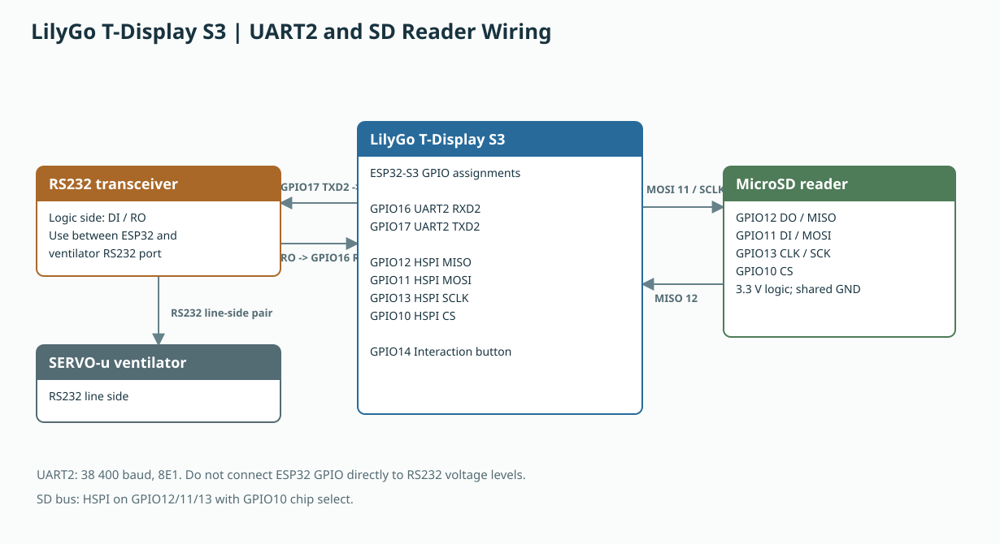
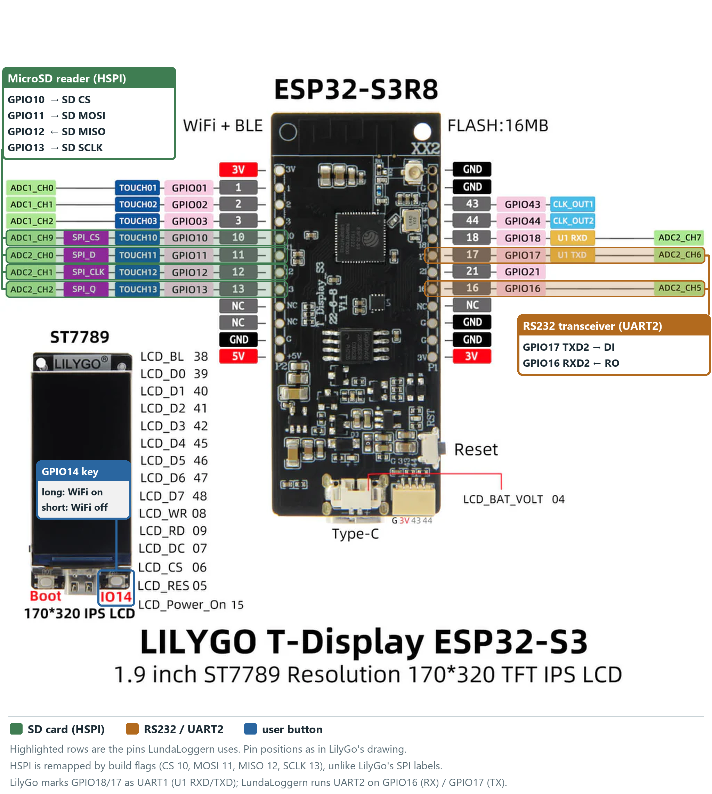
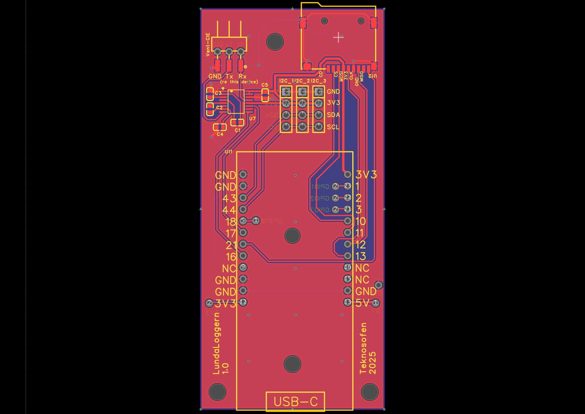
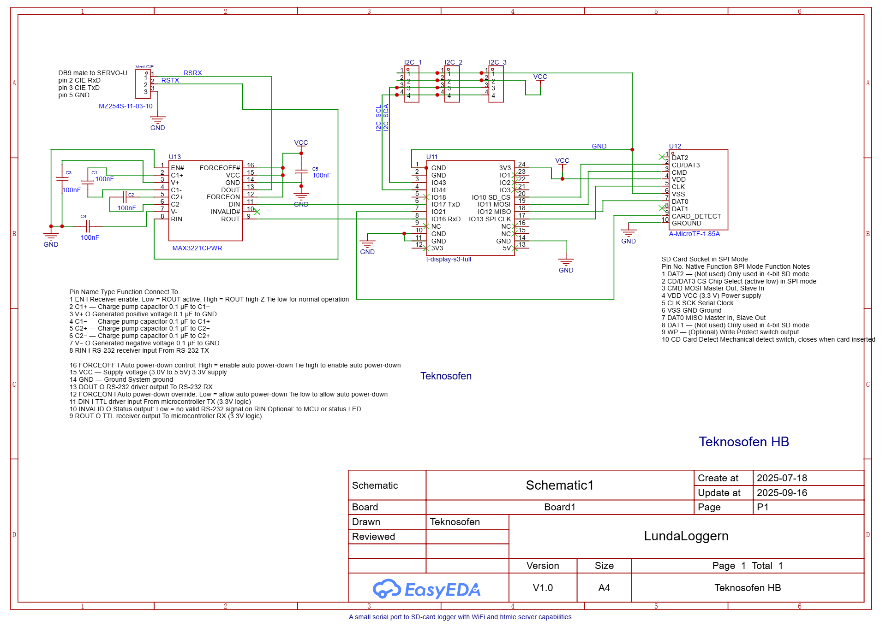
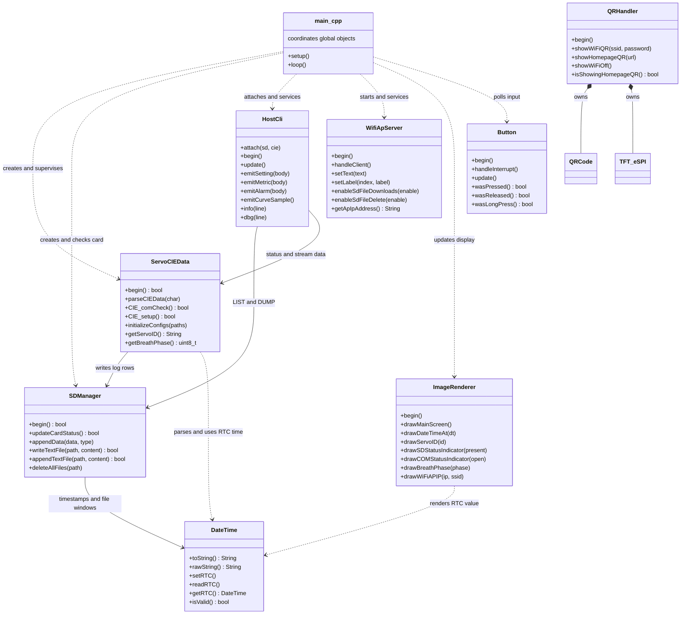

# LundaLoggern — Design Summary

**Version:** 1.3.0 (2026-05-18)  
**Author:** Åke L  
**Platform:** LilyGo T-Display S3 (ESP32-S3)  
**Framework:** Arduino (PlatformIO)

---

## 1. Purpose

LundaLoggern is a portable, standalone data logger designed for **SERVO-u intensive care ventilators**. It continuously captures real-time ventilator metrics, settings, waveform curve data, and **alarm events** via the ventilator's CIE (Computer Interface Equipment) serial interface and stores them as timestamped log files on an SD card. A built-in WiFi access point and web server allow clinical/engineering staff to download, review, and manage logged data wirelessly from any device with a browser.

---

## 2. Hardware Overview

| Component | Details |
|---|---|
| **Microcontroller** | ESP32-S3 (LilyGo T-Display S3) |
| **Display** | 170 × 320 px ST7789 TFT (integrated) |
| **Storage** | MicroSD card via HSPI bus + on-chip SPIFFS |
| **Serial Interface** | RS232 transceiver on UART2 (38 400 baud, 8E1) |
| **User Input** | Physical button on GPIO 14 (short/long press) |
| **Memory** | PSRAM enabled for image buffering |
| **WiFi** | ESP32 SoftAP mode (802.11 b/g/n) |

### Pin Assignments

| T-Display S3 GPIO | Firmware signal | Connected device / signal | Direction at logger |
|---|---|---|---|
| GPIO 12 | HSPI MISO | SD reader DO / MISO | SD reader → logger |
| GPIO 11 | HSPI MOSI | SD reader DI / MOSI | Logger → SD reader |
| GPIO 13 | HSPI SCLK | SD reader CLK / SCK | Logger → SD reader |
| GPIO 10 | HSPI CS | SD reader CS | Logger → SD reader |
| GPIO 16 | UART2 RX (`RXD2`) | RS232 transceiver receiver output (`RO`) | Transceiver → logger |
| GPIO 17 | UART2 TX (`TXD2`) | RS232 transceiver driver input (`DI` / `TXD`) | Logger → transceiver |
| GPIO 14 | Interaction button | Physical button input | Button → logger |

UART2 runs at 38 400 baud, 8E1. Connect the UART pins to the logic-side pins of an RS232 transceiver; connect the transceiver's RS232 line side to the ventilator. Do not connect ESP32-S3 GPIO directly to RS232 voltage levels. The SD reader uses the dedicated HSPI bus and GPIO10 as chip select. Use a 3.3 V logic-compatible SD interface and a shared ground.



To find the physical pins on the board, the LilyGo pinout drawing below has the pins used by LundaLoggern highlighted. Note that the project remaps HSPI with build flags (`HSPI_CS=10`, `HSPI_MOSI=11`, `HSPI_MISO=12`, `HSPI_SCLK=13` in `platformio.ini`), so the SD signals differ from LilyGo's default SPI labels, and that UART2 runs on GPIO16/17 rather than the UART1 pins LilyGo marks on GPIO18/17. The user button is the on-board IO14 key, not a header pin.



### Hardware Design — Schematic and PCB

The logger is built as a carrier board (EasyEDA design "LundaLoggern" V1.0, Teknosofen HB, 2025) that the T-Display S3 plugs into. It holds:

- **U13 — MAX3221 RS232 transceiver** with charge-pump capacitors C1–C4 and decoupling capacitor C5 (all 100 nF). DIN is driven by GPIO17 (TXD2) and ROUT feeds GPIO16 (RXD2). EN# is tied to GND and FORCEON / FORCEOFF# to VCC, so the transceiver is always on. INVALID# is not connected.
- **Vent-CIE — 3-pin header** (RSRX, RSTX, GND) for the cable to the ventilator's DB9 CIE port (DB9 pin 2 CIE RxD, pin 3 CIE TxD, pin 5 GND).
- **U12 — microSD socket** wired in SPI mode: CD/DAT3 = CS (GPIO10), CMD = MOSI (GPIO11), DAT0 = MISO (GPIO12), CLK = SCLK (GPIO13). The socket's card-detect switch is wired to GPIO21, but the current firmware does not read it (card presence is polled through the SD library instead).
- **I2C_1 … I2C_3 — three 4-pin expansion headers** (GND, 3V3, SDA, SCL) on GPIO43/GPIO44, for future sensors. They are not used by the current firmware.





---

## 3. Software Architecture

### 3.1 Architectural Style

The firmware uses a small, loop-driven embedded architecture. `main.cpp` owns the global device objects and coordinates their lifecycle; it is the application controller rather than a separate controller class. Hardware-facing modules expose narrow C++ interfaces, while `ServoCIEData` owns the CIE parsing and channel-processing logic. Dependencies are passed by reference or pointer where practical (`SDManager` receives the SPI bus and `DateTime`; `ServoCIEData` receives `SDManager`; `HostCli` is attached to the storage and CIE objects during setup).

### 3.2 Class Diagram

The diagram shows active runtime dependencies. `QRHandler` is also implemented, but is currently not instantiated or called by `main.cpp`.



### 3.3 Class Interfaces

| Class | Public interface and contract | Collaborators / notes |
|---|---|---|
| **`ServoCIEData`** | `begin()`, `parseCIEData(byte)`, `CIE_comCheck()`, and `CIE_setup()` manage CIE startup and byte-wise parsing. `initializeConfigs(...)` loads channel definitions. Getters expose device ID, breath phase, communication state, and alarm summaries. | Constructed with an `SDManager*`; writes metric, setting, and alarm rows through it. Uses `DateTime`/RTC for ventilator time. Channel configuration arrays are currently public. |
| **`SDManager`** | `begin()` mounts the card; `updateCardStatus()` reports presence transitions; `appendData(data, type)` routes a data row to its rolling log; text-file methods provide basic file operations. Busy/card state is queryable. | Constructed with an SPI bus, chip-select pin, and `DateTime*`. Owns the SD logging and file-name window logic. |
| **`HostCli`** | `attach(sd, cie)`, `begin()`, then non-blocking `update()` form the lifecycle. `emitSetting/Metric/Alarm/CurveSample()` mirror data only when the corresponding stream is enabled; `info()` and `dbg()` provide tagged output. | Receives `SDManager` and `ServoCIEData` pointers through `attach()`. Its command parser controls streams and provides status, headers, file listing/dump, and marker commands. |
| **`WifiApServer`** | `begin()` starts the AP/server; `handleClient()` services HTTP requests. Setters update dashboard text/values/labels; feature toggles control SD download and delete actions; `getApIpAddress()` reports the AP address. | Constructed with SSID and password. Its HTTP server provides dashboard, file-manager, and configuration-viewer routes. |
| **`ImageRenderer`** | `begin()` initializes the display; drawing methods update screen regions, device/time labels, SD/COM indicators, breath phase, and WiFi status. | Constructed with a `TFT_eSPI&`; `main.cpp` decides when status changes warrant a redraw. |
| **`DateTime`** | Value object with field accessors/mutators, validity, `toString()`/`rawString()`, and RTC read/write helpers. | Shared timestamp source for log naming and display. The CIE time response is parsed by `ServoCIEData`. |
| **`Button`** | `begin()` configures input; `handleInterrupt()` records edge events; `update()` advances press/debounce state; `wasPressed()`, `wasReleased()`, and `wasLongPress()` expose events to the caller. | `main.cpp` maps a long press to WiFi startup and a short press to WiFi shutdown. |
| **`QRHandler`** | `begin()`, `showWiFiQR()`, `showHomepageQR()`, and `showWiFiOff()` draw QR screens; `isShowingHomepageQR()` reports its view state. | Uses its own `TFT_eSPI` and `QRCode` members. It is not currently connected to the main setup/loop path. |

`Configs` is the channel record shared by the CIE parser: it carries channel/label/unit metadata, scale and offset, raw and scaled values, and an active flag. It is a data structure rather than a service class.

### 3.4 Runtime and Processing Logic

1. **Startup (`setup()`)**: Initialize USB-CDC and attach/start `HostCli`; initialize the display, ventilator UART, SPI bus, and SD card; mount SPIFFS; load metric, setting, curve, and alarm configurations; then start CIE initialization. Configure the web dashboard, enable its SD actions, and initialize the physical button. WiFi itself remains off until the operator requests it.
2. **Main loop (`loop()`)**: Each iteration reads available ventilator bytes and passes them to `ServoCIEData::parseCIEData()`, services HTTP requests and USB-CDC commands, and updates button state. A roughly 200 ms supervision interval refreshes the clock display, breath phase, and SD status; it also detects CIE timeouts and retries initialization when communication is down.
3. **CIE frame processing**: The parser uses a run-mode state machine to identify frame type, validate/interpret payloads, and update configured channel values. Metric, setting, and alarm rows are appended to SD and offered to the matching optional `HostCli` stream. Alarm snapshots are emitted on alarm changes. Curve samples are offered to USB only after a complete configured sample set; curve decimation is applied by `HostCli`, and curve data is not written to SD in this firmware revision.
4. **Time and files**: Ventilator time received during CIE initialization seeds the RTC. `SDManager` uses the timestamp to choose the active 12-hour file window and writes a header when a target log is new or empty. Configuration loading uses SD as the primary source and SPIFFS as fallback/sync, as detailed in § 4.
5. **Operator controls**: A button long press starts the WiFi AP and web server; a short press disconnects the AP and turns WiFi off. The web server is serviced continuously from the main loop, while file access and downloads are handled through the SD/web interfaces.

### 3.5 Data Flow

```
SERVO-u Ventilator
        |
        | RS232 / CIE protocol (38400 baud, 8E1)
        v
  +--------------+   parsed values   +------------+   file access   +--------------+
  | ServoCIEData | -----------------> | SDManager  | -------------> | WifiApServer |
  |   (parser)   |                    |  (SD card)|                 |    (HTTP)    |
  +------+-------+                    +------------+                 +--------------+
         |
         | device and phase state
         v
    +----------+      status / time      +---------------+
    | main.cpp | ----------------------> | ImageRenderer |
    |   loop   |                         |     (TFT)     |
    +----+-----+                         +---------------+
         |
         | button and HTTP servicing
         +-------------------+
         |                   |
         v                   v
     +--------+         +--------------+
     | Button |         | WifiApServer |
     +--------+         +--------------+

ServoCIEData -- enabled tagged streams --> HostCli -- USB-CDC --> Host PC
DateTime / RTC --------------------------> SDManager and main.cpp
```

1. **Ventilator → `ServoCIEData`**: Raw bytes arrive on UART2 and are parsed character-by-character through the CIE state machine. Its run modes distinguish breath measurements, settings, curves, phase, trends, alarms, errors, and initialization responses.
2. **`ServoCIEData` → `SDManager`**: Parsed and scaled metric and setting values, plus alarm priority/status snapshots, are formatted as tab-separated rows and appended to date-stamped files (`metrics_*.txt`, `settings_*.txt`, and `alarms_*.txt`). Alarm rows are written when subscribed alarm state changes. Curve samples are kept in memory and are not written to SD in this firmware revision.
3. **`ServoCIEData` → `HostCli` → USB-CDC**: Metric, setting, and alarm rows are offered to `HostCli`, which emits them only when the corresponding streams are enabled. Complete curve sample sets can also be emitted, subject to curve decimation. USB streaming is independent of SD logging.
4. **CIE state → `main.cpp` → `ImageRenderer`**: `main.cpp` reads device identity and breath phase from `ServoCIEData` and updates the TFT when needed. The parser does not call the renderer directly.
5. **`SDManager` → `WifiApServer` → browser**: With WiFi enabled, the HTTP interface exposes SD files for listing, download, and deletion, as well as the configuration viewer. `main.cpp` services HTTP requests each loop iteration.
6. **Ventilator time → `DateTime` → logs and display**: The CIE `RTIM` response seeds the RTC. `DateTime` supplies timestamps for log naming and display updates.

---

## 4. Configuration System

Configuration is stored as tab-separated text files, loaded from the SD card (with SPIFFS as fallback/sync). Four configuration types exist:

### MetricConfig.txt — Breath-by-breath measured values
| Column | Meaning | Example |
|---|---|---|
| Channel | CIE channel number | `113` |
| Label | Human-readable name | `VtCO2` |
| Unit | Engineering unit | `ml` |
| Scale Factor | Multiply raw value | `0.1` |
| Offset | Add after scaling | `0.0` |

### SettingConfig.txt — Ventilator settings
Same column format as metrics, using channel numbers in the 400-range (e.g., RR, MV, PEEP, FiO2, mode).

### CurveConfig.txt — High-frequency waveform channels
Adds an `active` flag (true/false) to enable/disable individual curve channels (Flow, Pressure, Volume, Edi, FCO2).

### AlarmConfig.txt — Ventilator alarm channels
Defines which SCI alarm channels (800–999) to subscribe to and log. Same tab-separated format as metrics/settings.

| Column | Meaning | Example |
|---|---|---|
| Channel | CIE alarm channel number (800–999) | `805` |
| Label | Human-readable alarm name | `Apnea` |
| Unit | Type identifier (always `AD`) | `AD` |
| Scale Factor | Not used for alarms (set to `1.0`) | `1.0` |
| Offset | Not used for alarms (set to `0.0`) | `0.0` |
| Active | Enable/disable this alarm channel | `true` |

Alarm data from SCI is transmitted as **priority/value byte pairs** (not gain/offset-scaled values). Each alarm has:
- **Priority**: `0` = undefined, `1` = low, `2` = medium, `3` = high
- **Status**: `0` = no alarm, `1` = alarm active, `2` = alarm active but silenced
- **Not applicable**: The special value `0x7EFF` indicates the alarm channel does not apply in the current ventilation mode.

Logged format is `prio:status` per channel (e.g., `3:1` = high priority, active; `0:0` = no alarm; `N/A` = not applicable).

Default channels include O2 concentration, EtCO2, airway pressure, apnea, gas supply, battery, disconnect, leakage, respiratory rate, minute volume, tidal volume alarms, and summary alarm channels (995–999).

### DeviceConfig.txt — Device-level settings
A key-value configuration file for parameters that govern the device itself (as opposed to ventilator data channels). Lines starting with `#` are comments.

| Key | Default | Description |
|---|---|---|
| `SSID` | `LundaLoggern` | WiFi access-point name |
| `Password` | `neonatal` | WiFi access-point password |
| `WiFiAutoOff_min` | `5` | Minutes of no connected clients before WiFi is automatically disabled. Set to `0` to disable auto-shutoff. |

### Configuration loading priority

**SD card → SPIFFS**. Bi-directional sync between SD and SPIFFS ensures resilience. If a configuration file is not found on the SD card (e.g., a fresh/empty card is inserted), the last known valid copy stored in SPIFFS is written to the SD card as a template. The operator can then edit it on the SD card and the changes will be picked up on next boot.

A load attempt is treated as successful only if at least one valid entry is parsed. An SD file that exists but is empty or contains no parseable lines is rejected, and the SPIFFS copy is used instead (and re-synced to SD). This prevents an accidentally truncated SD file from overwriting the SPIFFS factory defaults.

---

## 4a. Log File Formats

All log files are written to the SD card root as plain UTF-8 text with **tab-separated** fields and Unix-style newlines (`\n`). File names use the pattern `<type>_<YYYYMMDD>_<HHMM>.txt`, where the `HHMM` part is the start of the **12-hour rolling window** (`0000` or `1200` local time). When the window changes, a new file is created and the next write begins it with the header.

Header detection: a file is considered "new" (header is written) when it does not yet exist on the SD card or has size 0. Detection is per-file, so interleaved metric, setting and alarm writes never trigger spurious re-headers.

### `metrics_YYYYMMDD_HHMM.txt`

Breath-by-breath measurements (from SCI `B` frames).

```
Data from: <ServoID>
Timestamp	<label1>	<label2>	...	<labelN>
2026-04-28 13:05:19	12.0	No Valid Data	7.6	...
2026-04-28 13:05:24	12.0	No Valid Data	7.6	...
```

- One row per received breath frame.
- Values are **scaled** floating-point (`scale*raw - offset`) per `MetricConfig.txt`.
- Channels marked invalid by the ventilator (raw `0x7EFF`) appear as `No Valid Data`.

### `settings_YYYYMMDD_HHMM.txt`

Ventilator setting values (from SCI `S` frames). Same row format as metrics, using the channels and scaling defined in `SettingConfig.txt`.

### `alarms_YYYYMMDD_HHMM.txt`

Alarm-state snapshots, written **only when at least one subscribed alarm transitions** (becomes active, silenced, or clears). The SCI alarm stream is change-driven, so a quiet ventilator produces no rows.

```
Data from: <ServoID>
Timestamp	<label1>	<label2>	...	<labelN>
2026-04-28 13:42:11	0:0	0:0	3:1	0:0	N/A	2:2	0:0	...
```

Per-channel field is either `prio:status` or the literal `N/A`:

| Field | Code | Meaning |
|---|---|---|
| `prio` (priority) | `0` | undefined |
| | `1` | low |
| | `2` | medium |
| | `3` | high |
| `status` | `0` | no alarm |
| | `1` | alarm active |
| | `2` | alarm active but silenced |
| `N/A` | — | channel does not apply in current ventilation mode (raw `0x7EFF`) |

Example: `3:1` = high-priority active; `2:2` = medium-priority silenced; `0:0` = clear; `N/A` = not applicable.

The label order in the header matches the channel order in `AlarmConfig.txt`. To translate a row into named events, line up each tab-separated value with the corresponding header label.

### `curves_YYYYMMDD_HHMM.txt`

Reserved for waveform data (Flow / Press / Volume / Edi / FCO2). Curve data is currently parsed and stored in memory but **not written to SD** in the present firmware revision; the file name pattern is provided for forward-compatibility. Curve samples can, however, be streamed live over the USB-CDC port — see **§ 5a. USB-CDC Command Interface (HostCli)**.

### `log.txt`

Free-form diagnostic log used during board bring-up. Not part of the regular data stream and may be removed at any time.

---

## 5. Communication Protocol

The device communicates with SERVO ventilators using the **CIE (Computer Interface Equipment)** binary/ASCII protocol:

- **Physical layer**: RS232, 38 400 baud, 8 data bits, even parity, 1 stop bit (8E1)
- **Initialization**: Sends `RTIM` (request time), `RCTY` (request device type), `RSEN` (request serial number) commands to identify the ventilator.
- **Data subscription**: Sends `SDADB` / `SDADS` / `SDADA` / `SDADC` commands to subscribe to breath data, settings, alarm, and curve channels respectively.
- **Framing**: Uses `EOT` (0x04) and `ESC` (0x1B) as delimiters; CRC-8 for integrity.
- **Timeout handling**: If no data is received for 8 seconds, the connection is marked lost and re-initialization is attempted every 5 seconds.

---

## 5a. USB-CDC Command Interface (HostCli)

In addition to the ventilator-facing RS232 link, the device exposes a **line-oriented command and streaming interface on the USB-CDC port** (`hostCom`, 115 200 baud). This lets a connected PC selectively mirror logged data live, replay SD log files, and query device status — without touching the SD card or the WiFi web UI.

The interface is implemented by the `HostCli` class ([`include/HostCli.hpp`](../include/HostCli.hpp), [`src/HostCli.cpp`](../src/HostCli.cpp)). It is non-blocking and runs from the main loop via `hostCli.update()`.

### 5a.1 Wire format

All output lines are **tab-separated** and begin with an uppercase **TAG** that identifies their category. Lines are terminated by `\n`. The boot banner is:

```
READY	<version>	<SSID>
INFO	Type HELP for commands. All data streams are OFF at boot.
```

| Tag | Meaning |
|---|---|
| `READY` | Boot banner, emitted once after reset |
| `OK` | Command accepted; payload echoes effective state |
| `ERR` | Command rejected; payload describes the reason |
| `INFO` | Free-form informational text (also used inside `HELP` output) |
| `DBG` | Debug chatter; only emitted when `DEBUG ON` |
| `SETTING` | One settings row (or header/`Data from:` line) |
| `METRIC` | One metric row (or header/`Data from:` line) |
| `ALARM` | One alarm-state row (or header/`Data from:` line) |
| `CURVE` | One curve sample row, or the curve header line |
| `HEADER` | Explicit label header emitted by the `HEADER` command |
| `STATUS` | Key-value status line (`STATUS\t<key>=<value>`) |
| `FILE` | One entry in the `LIST` response (`FILE\t<name>\t<size>`) |
| `LIST_END` | End-of-list marker for `LIST` |
| `DUMP_BEGIN` / `DUMP_END` | Bracket raw file content emitted by `DUMP` |
| `MARK` | User-injected marker (`MARK\t<timestamp>\t<text>`) |

Data rows reuse the **same format as the SD log files**: the first `*` line of a stream is `Data from: <ServoID>`, the second is `Timestamp\t<label1>\t<label2>…`, and subsequent rows are `<RTC time>\t<v1>\t<v2>…`. Each such line is simply prefixed with its stream tag on the USB side, e.g.

```
METRIC	Data from: SERVO-u 12345
METRIC	Timestamp	VtCO2	MVe	RR	…
METRIC	2026-05-18 14:03:11	12.0	6.4	18	…
```

### 5a.2 Default state at boot

- All four data streams (Setting, Metric, Alarm, Curve) are **OFF**.
- `DEBUG` is **OFF**.
- Curve decimation is **1** (every sample emitted when the stream is on).
- Free-form `hostCom.println(...)` startup/WiFi messages that predate HostCli still appear (untagged) — they are informational and do not interfere with tagged lines.

### 5a.3 Commands

Commands are case-insensitive and terminated by `\n` (CR is ignored). Maximum input line length is 200 characters; an oversize line is rejected with `ERR\tinput line too long`.

| Command | Effect |
|---|---|
| `HELP`, `?` | List all commands |
| `VERSION`, `VER` | `OK\tVERSION <fw>` |
| `STATUS` | Emit a block of `STATUS\tkey=value` lines (fw, servoID, comOpen, sdPresent, rtc, psramFree, heapFree, wifiClients, stream, curveRate) terminated by `OK\tSTATUS` |
| `STREAM ON S\|M\|A\|C\|*` | Enable one or more data streams |
| `STREAM OFF S\|M\|A\|C\|*` | Disable one or more data streams |
| `STREAM ?` | Report current mask as `SMACD` (each char is the letter if enabled, `-` if not). The 5th char is the `DEBUG` flag. |
| `DEBUG ON\|OFF\|?` | Gate `DBG` lines |
| `HEADER S\|M\|A\|C` | Re-emit the current label header for that stream (useful when a PC tool attaches mid-session) |
| `RATE C <n>` | Emit every Nth curve sample, `n ∈ [1, 10000]`. Decimation is currently only supported on the curve stream. |
| `FORMAT [TSV\|?]` | Reports/sets output format. Only `TSV` is supported in this build; the command exists so a PC tool can probe and future formats can be added without protocol changes. |
| `LIST` | List files on the SD card root as `FILE\t<name>\t<size>` lines, followed by `LIST_END` and `OK\tLIST` |
| `DUMP <filename>` | Stream the contents of an SD file verbatim, bracketed by `DUMP_BEGIN\t<path>\t<size>` and `DUMP_END\t<path>`. File content is emitted **unmodified** (no per-line tagging) so the same parser used on the SD card can consume it directly. |
| `MARK <text>` | Inject `MARK\t<RTC time>\t<text>` — useful for annotating tests |
| `TIME` | Report RTC time. Setting the RTC from the host is intentionally rejected (`ERR`) because the firmware syncs the RTC from the ventilator on every CIE init. |

### 5a.4 Curve streaming

Curves are **not** logged to SD (see § 4a `curves_*.txt`). They are only available over USB-CDC, and only when explicitly enabled. The first sample emitted after `STREAM ON C` is preceded by a header line:

```
CURVE	Timestamp	<label0>	<label1>	…
CURVE	2026-05-18 14:03:11.42	12.7	-3.1	0.05	…
```

Labels and channel count come from `CurveConfig.txt`. Values are the scaled floats from `curves[i].scaled`, formatted with 2 decimal places. One `CURVE` row is emitted per **complete sample set** (i.e. once all `curveCount` channels have been refreshed), subject to the `RATE C <n>` decimation factor.

> **Bandwidth caution.** At native rate the SERVO curve channel produces tens of samples per second across multiple channels. The USB-CDC link can carry this, but: (1) it can saturate slow terminal programs, and (2) printing curves while also running `STREAM ON M S A` and `DEBUG ON` will interleave a lot of text. Use `RATE C n` to thin the stream, or only enable curves for short captures.

### 5a.5 Example session

```
> VERSION
OK	VERSION 1.3.0

> STREAM ON M,A
OK	STREAM -M A--

> HEADER M
METRIC	Timestamp	VtCO2	MVe	RR	…
OK	HEADER M

> STATUS
STATUS	fw=1.3.0
STATUS	servoID=SERVO-u 12345
STATUS	comOpen=1
STATUS	sdPresent=1
STATUS	rtc=2026-05-18 14:03:11
STATUS	psramFree=2087612
STATUS	heapFree=204880
STATUS	wifiClients=0
STATUS	stream=-M A--
STATUS	curveRate=1/1
OK	STATUS

> DUMP metrics_20260518_1200.txt
DUMP_BEGIN	/metrics_20260518_1200.txt	4821
Data from: SERVO-u 12345
Timestamp	VtCO2	MVe	RR	…
2026-05-18 12:00:04	12.0	6.4	18	…
…
DUMP_END	/metrics_20260518_1200.txt
OK	DUMP /metrics_20260518_1200.txt
```

### 5a.6 Integration points

- `setup()` in [`src/main.cpp`](../src/main.cpp) calls `hostCli.attach(&sd, &servoCIEData); hostCli.begin();`.
- `loop()` calls `hostCli.update();` once per iteration.
- The Setting/Metric/Alarm emit sites in [`src/ServoCIEData.cpp`](../src/ServoCIEData.cpp) now call `hostCli.emitSetting/Metric/Alarm(dataStr)` instead of writing directly to `hostCom`. SD logging is unaffected.
- `handleValueData()` calls `hostCli.emitCurveSample()` whenever `CurveCounter` wraps back to 0, i.e. once per complete sample set.
- Bulky `[DBG] appendData …` lines in [`src/SDManager.cpp`](../src/SDManager.cpp) are routed through `hostCli.dbg(...)` and are silent unless `DEBUG ON` is in effect.

---

## 6. WiFi & Web Interface

- **SSID**: `LundaLoggern` (password: `neonatal`)
- **IP**: Default SoftAP IP (`192.168.4.1`)
- **Default state**: WiFi and the web server are **off by default**. The operator must manually start them with a long-press of the physical button. A short-press shuts them down again. This minimises power consumption and RF interference in sensitive clinical environments.
- **Web pages**:
  - **Home / Dashboard**: Displays version, device ID, status labels, and logo.
  - **File Manager**: Lists all SD card log files with download and delete actions.
  - **Config Viewer**: Shows the currently loaded configuration files from SPIFFS: `DeviceConfig.txt`, `MetricConfig.txt`, `SettingConfig.txt`, `CurveConfig.txt`, and `AlarmConfig.txt`.
- **QR Code**: Display can show a QR code for quick WiFi connection from a phone.

---

## 7. Display Layout

The 320 × 170 TFT is divided into functional zones:

| Zone | Content |
|---|---|
| Top-left | LundaLoggern logo (100 × 100 px) |
| Top-right | Version label |
| Center-right | Connected ventilator type + serial number |
| Bottom-right | Date & time (from ventilator RTC) |
| Right status bar | SD card indicator, COM link indicator, breath-phase indicator |
| Bottom band | WiFi status (AP IP, SSID, prompt to enable/disable) |

---

## 8. Build & Dependencies

**PlatformIO environment**: `lilygo-t-display-s3`

| Library | Version | Purpose |
|---|---|---|
| `bodmer/TFT_eSPI` | 2.5.43 | TFT display driver |
| `ricmoo/QRCode` | ^0.0.1 | QR code generation |
| Arduino core | — | WiFi, SPI, SD, SPIFFS |

**Build flags**: USB CDC on boot, HSPI pin definitions, display variant selection.

### 8.1 Preparing a New Board (First-Time Setup)

When programming a brand-new LilyGo T-Display S3, three separate upload steps are needed:

#### Step 1 — Upload the SPIFFS filesystem image

The `data/` folder contains factory-default configuration files and image assets that must be flashed to the on-chip SPIFFS partition. This only needs to be done **once per new board** (or after a full flash erase), and again whenever files in `data/` are changed.

**From the PlatformIO CLI** (VS Code terminal):

```
pio run --target uploadfs
```

**From the VS Code GUI**: Open the PlatformIO sidebar → Project Tasks → *lilygo-t-display-s3* → Platform → **Upload Filesystem Image**.

This uploads the following files to SPIFFS:

| File | Purpose |
|---|---|
| `MetricConfig.txt` | Breath-by-breath metric channel definitions |
| `SettingConfig.txt` | Ventilator setting channel definitions |
| `CurveConfig.txt` | Waveform curve channel definitions |
| `AlarmConfig.txt` | Alarm channel subscriptions (800–999) |
| `DeviceConfig.txt` | WiFi SSID, password, and auto-off timeout |
| `LogoWeb.png` | Logo served by the web interface |
| `logo150.bmp` | Logo displayed on TFT (loaded to PSRAM) |

> **Note:** SPIFFS does not support subdirectories. All files are placed in the root `/` of the SPIFFS partition.

If SPIFFS needs to be erased/reformatted (e.g. corruption or partition layout change):

```
pio run --target cleanfs
```

Then re-upload the filesystem image with `uploadfs`.

#### Step 2 — Upload the firmware

```
pio run --target upload
```

Or use PlatformIO sidebar → **Upload**.

#### Step 3 — Prepare the SD card

Insert a FAT32-formatted MicroSD card. On first boot the device will attempt to read configuration files from the SD card. If they are not found, it falls back to SPIFFS and automatically copies its factory defaults to the SD card (`syncConfigSPIFFSToSD`). From that point on, the SD card copy is the primary configuration source.

To use **customised** configurations, place edited copies of `MetricConfig.txt`, `SettingConfig.txt`, `CurveConfig.txt`, `AlarmConfig.txt`, and/or `DeviceConfig.txt` on the SD card root before first boot. The device will load those and sync them back to SPIFFS.

### 8.2 TFT_eSPI Library Configuration

The TFT_eSPI library requires a one-time manual setup in its installed library folder. After the first build (which downloads the library), locate the TFT_eSPI folder inside `.pio/libdeps/lilygo-t-display-s3/TFT_eSPI/` and verify:

1. **`User_Setup_Select.h`** — Ensure the LilyGo T-Display S3 setup is enabled:
   ```cpp
   #include <User_Setups/Setup206_LilyGo_T_Display_S3.h>
   ```
   All other `#include` lines for other boards should be commented out.

2. Alternatively, the project includes `include/My_Display_Setup.h` which defines:
   - `ST7789_DRIVER`
   - `TFT_WIDTH 170` / `TFT_HEIGHT 320`
   - The correct SPI pin assignments for the T-Display S3

### 8.3 Rebuilding After Configuration Changes

| What changed | Action needed |
|---|---|
| Source code (`.cpp` / `.hpp`) | `pio run --target upload` |
| Files in `data/` folder | `pio run --target uploadfs` (re-flash SPIFFS) |
| Config files on SD card only | No rebuild — just reboot the device |
| `platformio.ini` build flags | Clean build: `pio run --target clean` then `pio run --target upload` |
| TFT_eSPI library settings | Delete `.pio/libdeps/` and rebuild, then re-apply display setup |

---

## 9. File Structure

```
LundaLoggern/
├── platformio.ini              # Build configuration
├── README.md                   # Project overview
├── data/                       # SPIFFS data (uploaded via pio uploadfs)
│   ├── MetricConfig.txt
│   ├── SettingConfig.txt
│   ├── CurveConfig.txt
│   ├── AlarmConfig.txt         # Alarm channel subscriptions (800-999)
│   └── DeviceConfig.txt        # SSID, password, WiFi auto-off
├── Documentation/              # Non-code documentation
├── include/                    # Header files
│   ├── main.hpp                # Global includes, pin defs, constants
│   ├── ServoCIEData.hpp        # CIE protocol & data management
│   ├── SDmanager.hpp           # SD card abstraction
│   ├── WifiApServer.hpp        # WiFi AP & HTTP server
│   ├── HostCli.hpp             # USB-CDC command / stream interface
│   ├── ImageRenderer.hpp       # TFT display rendering
│   ├── DateTime.hpp            # Date/time object & RTC
│   ├── Button.hpp              # Button input handler
│   ├── QRHAndler.hpp           # QR code display
│   ├── constants.h             # Display position constants
│   └── ...                     # Fonts, logo bitmap
├── src/                        # Implementation files
│   ├── main.cpp
│   ├── ServoCIEData.cpp
│   ├── SDManager.cpp
│   ├── WifiApServer.cpp
│   ├── HostCli.cpp
│   ├── ImageRenderer.cpp
│   ├── DateTime.cpp
│   ├── Button.cpp
│   └── QRHandler.cpp
└── LundaLoggern_logo/          # Logo source assets
```

---

## 10. Key Design Decisions

1. **SD + SPIFFS dual storage**: Configurations live in both locations for resilience. SPIFFS holds factory defaults; SD card holds user overrides.
2. **Character-by-character CIE parsing**: A state machine processes each incoming byte, allowing the main loop to remain non-blocking.
3. **Button-controlled WiFi**: WiFi and the web server are off by default to minimise power consumption and RF interference in clinical environments. The operator must explicitly activate them via a long-press of the interaction button, and can shut them down again with a short-press.
4. **Ventilator-derived time**: No RTC module is needed; the device obtains accurate timestamps from the connected ventilator.
5. **Configurable channels**: Which metrics, settings, curves, and alarms to log are fully configurable via text files, enabling adaptation to different clinical needs without recompilation.
6. **Alarm logging**: Alarm data is parsed from the SCI `RADC` continuous data stream (flag byte `0x41` / `'A'`), which transmits priority/status byte pairs whenever any subscribed alarm state changes. Up to 100 alarm channels can be subscribed via the `SDADA` command. Alarms are logged to separate `alarms_YYYYMMDD_HHMM.txt` files with the same 12-hour rolling window as metrics and settings.

---

## 11. Planned Improvements

### 11.1 WiFi Auto-Shutoff — Implementation Analysis

**Goal**: Automatically disable the WiFi access point and web server when no client has been connected for a configurable idle period (default 5 minutes, configurable via `WiFiAutoOff_min` in `DeviceConfig.txt`). This reduces unnecessary RF exposure and power draw in the NICU.

#### Existing behaviour (reference)

The WiFi AP and web server are **off by default**. The operator starts them with a long-press on the interaction button. The shutdown path already exists in [main.cpp](../src/main.cpp) (short-press handler):

```cpp
WiFi.softAPdisconnect(true);
WiFi.mode(WIFI_OFF);
renderer.drawWiFiAPIP("WiFi OFF      ", "No SSID        ");
renderer.drawWiFiPromt("Press key to enable");
```

The ESP32 API `WiFi.softAPgetStationNum()` returns the number of currently connected SoftAP clients — this is already referenced in a comment in `main.cpp`.

#### Implementation plan

The feature requires changes in three areas:

##### A. Load `DeviceConfig.txt` at startup

A new key-value parser (simpler than the channel-config parser) reads `DeviceConfig.txt` from SD (SPIFFS fallback) during `setup()`. Parsed values replace the compile-time `#define LOGGER_SSID` / `#define LOGGER_PW` constants and populate a new `wifiAutoOffMinutes` variable.

**Where**: Add a `loadDeviceConfig()` function. This can live in a small new class (e.g., `DeviceSettings`) or be added to `ServoCIEData` / a free function. The same SD → SPIFFS fallback/sync pattern used by `initializeConfigs()` applies.

**Pseudocode**:
```cpp
struct DeviceSettings {
    String   ssid            = "LundaLoggern";
    String   password        = "neonatal";
    uint16_t wifiAutoOff_min = 5;   // 0 = disabled
};

bool loadDeviceConfig(const char* path, DeviceSettings& cfg);
```

##### B. Track idle time in `WifiApServer`

Add three members to the `WifiApServer` class:

```cpp
// WifiApServer.hpp — new private members
bool     _wifiActive        = false;  // true after begin() is called
uint16_t _autoOffMinutes    = 5;      // 0 = disabled
unsigned long _lastClientSeen = 0;    // millis() timestamp
```

Add a public method to configure and a method to check the idle timer:

```cpp
// WifiApServer.hpp — new public methods
void setAutoOffMinutes(uint16_t minutes);
bool checkAutoOff();  // returns true if WiFi was shut down
```

**`checkAutoOff()` logic** (called from the slow-loop in `main.cpp`):

```
if WiFi is not active, or auto-off is disabled (== 0):
    return false

clientCount = WiFi.softAPgetStationNum()

if clientCount > 0:
    _lastClientSeen = millis()       // reset timer
    return false

if (millis() - _lastClientSeen) > (_autoOffMinutes * 60000):
    shut down WiFi (same code as the short-press handler)
    _wifiActive = false
    return true                      // caller updates display

return false
```

##### C. Integrate into the main loop

In the existing slow-loop block in `main.cpp` (the `if (micros() - loopStartTime > SET_LOOP_TIME)` section), add:

```cpp
if (myWiFiServer.checkAutoOff()) {
    hostCom.println("WiFi auto-off: no clients for timeout period");
    renderer.drawWiFiAPIP("WiFi OFF      ", "No SSID        ");
    renderer.drawWiFiPromt("Press key to enable");
}
```

Also update the long-press handler to pass the loaded SSID/password and reset the idle timer:

```cpp
myWiFiServer.begin();   // already exists
myWiFiServer.resetIdleTimer();  // new — sets _lastClientSeen = millis()
```

#### Summary of changes

| File | Change |
|---|---|
| `data/DeviceConfig.txt` | New file — SSID, Password, WiFiAutoOff_min |
| `main.hpp` | Remove hard-coded `LOGGER_SSID` / `LOGGER_PW` defines; add `DeviceSettings` struct or include |
| `main.cpp` `setup()` | Call `loadDeviceConfig()`; pass loaded SSID/password to `WifiApServer` constructor or a setter |
| `main.cpp` loop | Call `myWiFiServer.checkAutoOff()` in the slow-loop; update display if it returns `true` |
| `WifiApServer.hpp` | Add `_wifiActive`, `_autoOffMinutes`, `_lastClientSeen` members; add `setAutoOffMinutes()`, `checkAutoOff()`, `resetIdleTimer()` methods |
| `WifiApServer.cpp` | Implement `checkAutoOff()` using `WiFi.softAPgetStationNum()` and the shutdown sequence |
| `ServoCIEData.cpp` or new file | `loadDeviceConfig()` with SD → SPIFFS fallback/sync |

#### Edge cases to consider

- **WiFiAutoOff_min = 0**: Feature disabled — WiFi stays on until manual short-press.
- **Client connects then disconnects**: Timer resets on every poll where `clientCount > 0`; countdown only begins after the last client disconnects.
- **WiFi never started**: `checkAutoOff()` returns `false` immediately if `_wifiActive == false`.
- **Operator re-enables WiFi after auto-off**: Long-press works normally, resets the idle timer.
- **Missing DeviceConfig.txt**: Hard-coded defaults (`LundaLoggern` / `neonatal` / 5 min) are used, matching current behaviour.
